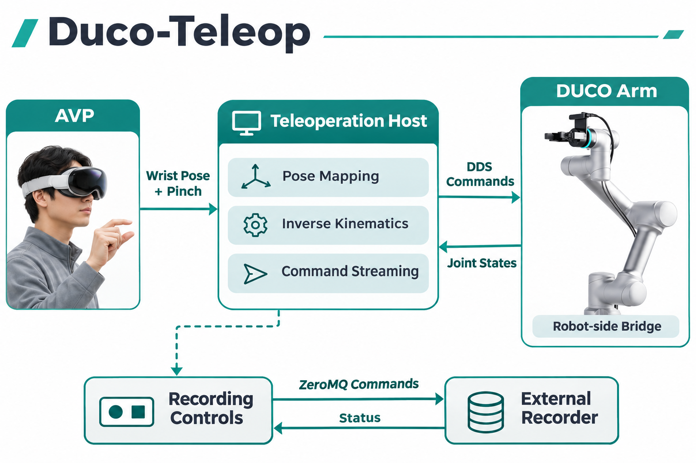

  
  <h1>Duco-Teleop</h1>
  
<strong>Apple Vision Pro teleoperation and demonstration capture controls for a DUCO arm</strong>

  
<a href="README.md">中文</a> · English

Map wrist motion to end-effector targets, control the gripper through pinch input, and coordinate demonstration capture through a separate recording interface. Built on Unitree's xr_teleoperate framework, with independently developed adaptations for a six-axis DUCO arm.

## Real-robot demo

[Watch the approximately 30-second teleoperation demo →](media/duco-teleop-demo.mp4)

## Project contributions

| Module | Implementation | Source |
| --- | --- | --- |
| Native AVP AR teleoperation and pose mapping | Native Apple ARKit hand tracking via VisionProTeleop / avp_stream, adapted for real-environment AR teleoperation; thumb–index geometry reconstructs control poses and pinch values for relative motion, orientation following and gripper control | [AVP adapter](teleop/televuer/src/televuer/visionpro_tv_wrapper.py) · [Hand geometry](teleop/televuer/src/televuer/hand_pose_utils.py) |
| DUCO motion control | Constrained IK, joint limits, smoothing and position-priority fallback; independent joint and gripper command streaming | [IK solver](teleop/robot_control/duco_arm_ik.py) · [DDS controller](teleop/robot_control/duco_arm_controller.py) |
| Capture interaction | Preview, start, keep, discard, skip reset and abort; ZeroMQ commands and status messages exchanged with an external recorder | [Recording client](teleop/record_zmq.py) |

## System overview

Wrist poses pass through pose mapping and inverse kinematics to become joint targets. Joint and gripper commands travel over DDS to the robot side, with joint-state feedback used in subsequent solves. Recording commands and status use a separate ZeroMQ channel; an external recorder handles data acquisition and storage.

The supplied robot image illustrates the hardware; mobile-base teleoperation is outside this project's scope. See the [source-grounded data-flow notes](docs/data-flow.md) in Chinese for implementation details.

## Design highlights

- **Relative motion mapping:** wrist displacement is measured from an initial reference and mapped to robot-base directions.
- **Position-priority fallback:** when pose-following exceeds the position-error threshold, the controller tries a fixed-reference-orientation IK solution and selects it only if its position error is smaller.
- **Decoupled input and streaming:** the main loop updates targets while a separate controller thread publishes commands and receives joint feedback.

## Acknowledgements

Built on [Unitree xr_teleoperate](https://github.com/unitreerobotics/xr_teleoperate). Thanks to its authors for the open XR teleoperation framework and related dependencies. The DUCO adaptation retains upstream communication infrastructure and code. This project is not affiliated with Unitree or Apple.

Original upstream introductions, device documentation and release notes are preserved under [docs/upstream](docs/upstream) as historical references, not a DUCO feature list. The original [license and copyright notice](LICENSE) are retained.

Native tracking is provided by [VisionProTeleop / Tracking Streamer](https://github.com/Improbable-AI/VisionProTeleop), using Apple ARKit. The custom input adapter is included in this repository; see [source provenance](teleop/televuer/DUCO_SOURCE.md).
