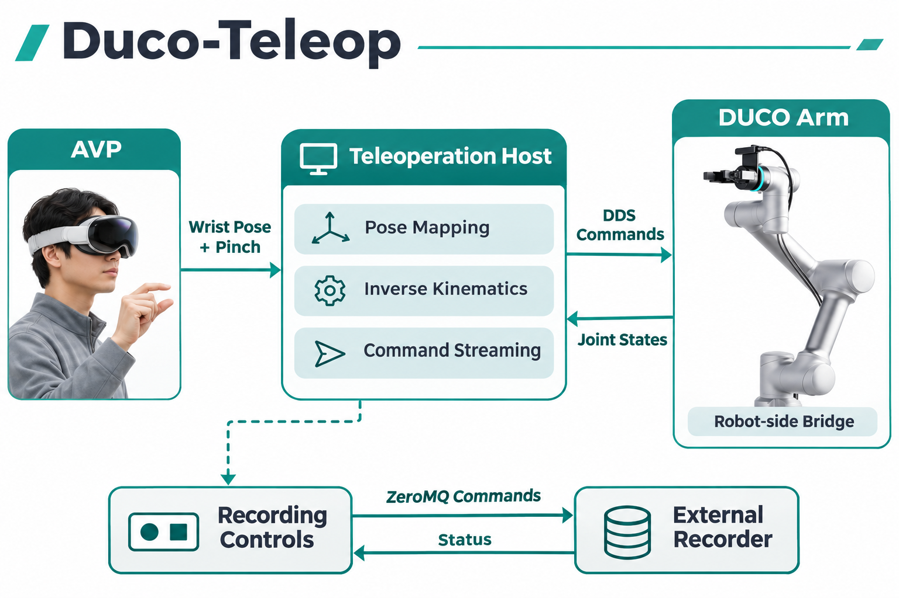

  
  <h1>Duco-Teleop</h1>
  
<strong>Apple Vision Pro 驱动的 DUCO 单臂遥操作与示范采集交互</strong>

  
中文 · <a href="README.en.md">English</a>

将手腕动作映射为机械臂末端目标，用捏合输入控制夹爪，并通过独立的录制交互链路组织示范采集。基于 Unitree 的 xr_teleoperate 框架，个人独立完成面向 DUCO 六自由度单臂的适配与开发。

## 实机演示

[观看约 30 秒的遥操作演示 →](media/duco-teleop-demo.mp4)

## 核心工作

| 模块 | 实现内容 | 代码入口 |
| --- | --- | --- |
| AVP 原生 AR 遥操作与位姿映射 | 通过 VisionProTeleop / avp_stream 接入基于 Apple ARKit 的原生手部追踪，完成真实环境中的 AR 遥操作适配；根据拇指与食指几何关系重建控制位姿和捏合值，支持相对位移、姿态跟随与夹爪控制 | [AVP 适配](teleop/televuer/src/televuer/visionpro_tv_wrapper.py) · [手部几何](teleop/televuer/src/televuer/hand_pose_utils.py) |
| DUCO 运动控制 | 约束逆运动学、关节限位、平滑处理与位置优先回退；独立线程发送关节及夹爪命令 | [IK 求解](teleop/robot_control/duco_arm_ik.py) · [DDS 控制器](teleop/robot_control/duco_arm_controller.py) |
| 示范采集交互 | 预览、开始、保留、丢弃、跳过复位与中止；通过 ZeroMQ 向外部录制服务发送指令并接收状态 | [录制客户端](teleop/record_zmq.py) |

## 系统链路

手腕位姿经映射与逆运动学转换为关节目标，与夹爪目标一起通过 DDS 发往机器人侧；关节状态回传用于后续求解。录制指令与状态走独立的 ZeroMQ 链路，实际数据采集与保存由外部录制服务承担。

机器人图片用于展示设备，图中的移动底座不属于本项目遥操作范围。详细数据流与源码依据见 [链路说明](docs/data-flow.md)。

## 设计要点

- **相对运动映射**：以初始化时的手腕位姿为参考，将操作者位移映射到机器人基座方向。
- **位置优先回退**：姿态跟随导致位置误差超出阈值时，尝试固定参考姿态的 IK 解，并比较位置误差后选择。
- **输入与发送解耦**：主循环更新目标，控制器独立发送线程维护命令流，并订阅关节反馈。

## 致谢与来源

本项目基于 [Unitree xr_teleoperate](https://github.com/unitreerobotics/xr_teleoperate) 开发，感谢其开放的 XR 遥操作框架及相关依赖。DUCO 适配保留了上游通信设施和代码基础；本仓库不隶属于 Unitree 或 Apple。

原始上游介绍、设备文档与更新记录保存在 [docs/upstream](docs/upstream)，仅作为历史参考，不代表 DUCO 项目的功能清单。原有 [许可证与版权声明](LICENSE) 保留。

原生 AVP 追踪接入使用 [VisionProTeleop / Tracking Streamer](https://github.com/Improbable-AI/VisionProTeleop)，感谢其提供基于 Apple ARKit 的追踪数据接口。定制输入模块已随仓库收录，见[源码来源](teleop/televuer/DUCO_SOURCE.md)。
